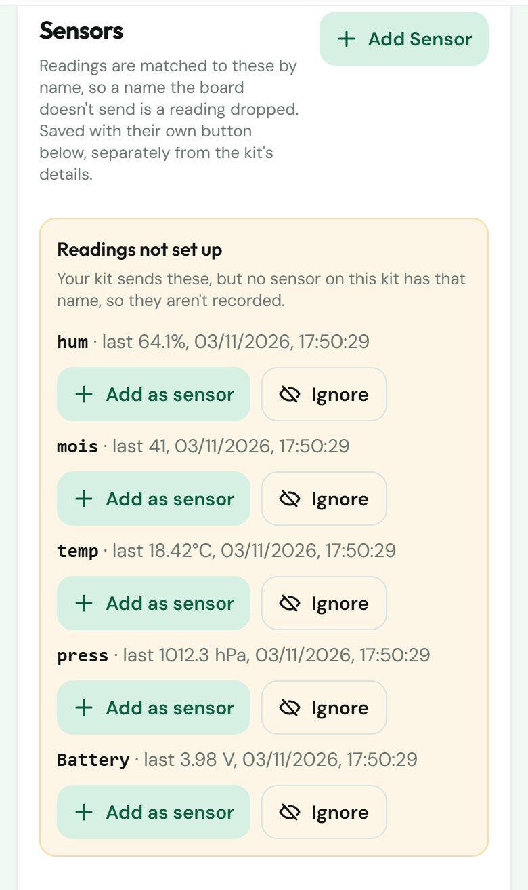

## How to setup the TeleAgriCulture V2.1 board

First connect Power (via USB or Solar Board)

Switch board into Config Mode (new boards start into config mode)

- to enter the Config Mode later (with open Config Portal):
- - press BOOT BUTTON > 5 sec or 
- - Double Reset the board (reset, 1, 2, 3, reset again)

Connect to board via WiFi (on your Mobile phone or Notebook)

**WiFi Network Name (SSID):**
- **Config Portal AP**: `TAC_config_XXXX` (e.g. `TAC_config_A1B2`) — unique per board, `XXXX` = last 4 hex digits of the MAC address
- _Older firmware (v1.75 and earlier) used a static SSID on all boards: `TeleAgriCulture Board`_

**Password**: `enter123`

Config Portal opens automatically or open IP: 192.168.4.1 in a browser (on the device you connected to the Board WiFi)

> **iPhone / iPad (iOS 14+)**
> iOS tries to detect the config portal over HTTPS first, which the board does not support. It falls back to HTTP after a few seconds — the "Login to network" popup will appear, just with a short delay (3–5 s). If the popup does not appear at all, open **Safari** and navigate manually to **`http://192.168.4.1`**. This bypasses the automatic detection entirely and opens the config portal directly.

Now you can change your board settings (WiFi Network, Upload, Sensors, Timezone...)

If you use the Update Option:

>find the current compiled firmware for OTA upload (Board Setup on the Config Portal) here:
>[current Firmware](../Firmware) (current version 1.96)
>
>**If you are using LORA please choose the right Firmware for your location / lora module**
>and you have to enter your credentials for LoRa on the Config Portal

## Connect your board to kits.teleagriculture.org

### 1. Make an account

Sign up at [kits.teleagriculture.org/register](https://kits.teleagriculture.org/register).

### 2. Get your kit on your account

You can't create a kit yourself. If your kit came from the shop or a workshop, it is already on your account. Otherwise, ask an admin or the kit's owner to add you.

Your kits are listed under **My Kits** once you log in.

### 3. Give the board its Kit ID and API key

Skip this step if your board was set up for you. Boards from the shop and from workshops already have both.

Open your kit, then **More** → **Configure**:

- the **Kit ID** is at the top, under Configuration
- the **API key** is under API Security (only owners see it)

On the board's Config Portal, open **Board Setup** and enter them as **Board ID** and **API KEY**. If your board uses LoRa, enter its LoRa keys there too; an admin can give you those.

Don't refresh the API key on the website unless you mean to. The board stops reporting until you enter the new key on it.

### 4. Wait for the first readings

The board sends its readings on the Upload Interval set in Board Setup. At the usual 60 minutes, it sends on the hour.

### 5. Add your sensors

The board sends each reading under a short name, such as `temp`, `hum` or `mois`. A board with two of the same sensor adds a number: `temp1`, `temp2`. The website only records a reading if the kit has a sensor with exactly that name.

Kits from the shop come with their sensors already added. Do this step for a board you set up yourself, or when you plug in a new sensor.

You don't need to know the names. Once readings arrive, open **More** → **Configure**. Under **Readings not set up** you'll see every name your board sends:

- press **Add as sensor** for each reading you want to keep
- press **Ignore** for one you don't want, such as `Battery` on a board without a battery
- press **Save Sensors**

Readings are recorded from the next upload on.

### 6. Finish your kit's details (optional)

On the same page you can set where the kit is, what it is used for, and whether it shows publicly on the map.

>**For more about the source code, or to help with the coding, see the** [Docu Page](README.md). It also has a section on the sensors the board supports.

## Implemented Sensors

For a complete list of all implemented sensors with technical details, see [README.md - Implemented Sensors](../README.md#implemented-sensors).

Quick list: ADS1115, BATTERY, BH_1745, BH_1750, BME_280, BMP_280, BMP_680, CAP_SOIL, CAP_GROOVE, DFR FLAME, DFR LIGHT, DFR LM35, DHT11, DHT22, DS18B20, HEART_RATE, LEVEL, LIS331HH, LTR_390, MultiGasV1, MultiGasV2, PRE_LVL, RTCDS3231, SCD4x, SERVO, SHT_21, SOUND, SPF_WINDVANE, SPF_ANEMOMETER, TDS, UV_DFR, VEML7700, WS2812
